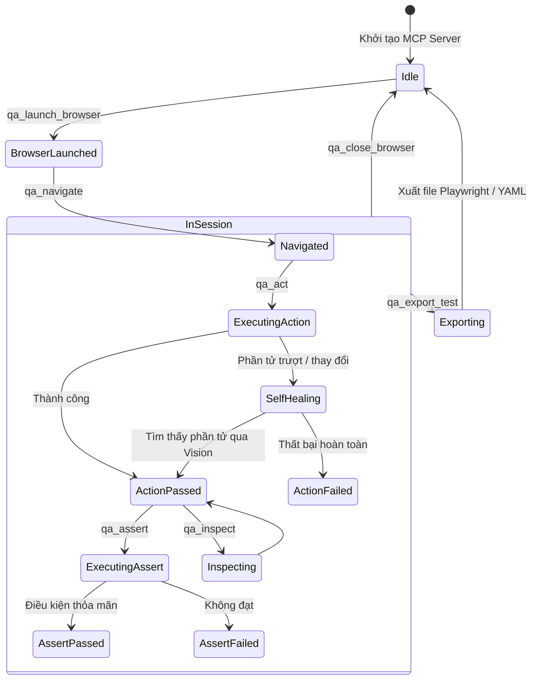

# Data Model: QA Pilot Agentic Platform

## Core Entities & Schema Definitions

### 1. `QASession`
Đại diện cho một phiên làm việc kiểm thử tương tác đang diễn ra giữa Antigravity Agent và trình duyệt.

```typescript
export interface QASession {
  sessionId: string;                  // UUID của phiên kiểm thử
  startedAt: string;                  // ISO 8601 timestamp
  status: 'idle' | 'running' | 'completed' | 'error';
  browserMode: 'headed' | 'headless'; // Trình duyệt hiển thị hay chạy ngầm
  currentUrl?: string;                // URL hiện tại của trang web
  environment: EnvironmentConfig;     // Cấu hình môi trường hiện tại
  steps: QAStep[];                    // Lịch sử các bước đã thực thi
  reportDir: string;                  // Đường dẫn lưu báo cáo visual (tests/runs/<sessionId>)
}
```

### 2. `QAStep`
Ghi lại từng hành động hoặc xác thực được thực thi trong phiên.

```typescript
export type StepType = 'navigate' | 'act' | 'assert' | 'inspect';
export type StepStatus = 'passed' | 'failed' | 'skipped' | 'warning';

export interface QAStep {
  stepIndex: number;                  // Thứ tự bước (1-based)
  type: StepType;                     // Loại bước
  instruction: string;                // Câu lệnh ngôn ngữ tự nhiên (VD: "click nút Đăng ký")
  status: StepStatus;                 // Trạng thái thực thi
  durationMs: number;                 // Thời gian thực thi (mili-giây)
  screenshotBefore?: string;          // Đường dẫn ảnh chụp trước khi thao tác
  screenshotAfter?: string;           // Đường dẫn ảnh chụp sau khi thao tác
  errorMessage?: string;              // Thông báo lỗi (nếu thất bại)
  remedyAttempted?: boolean;          // Đã kích hoạt cơ chế tự phục hồi hay chưa
  redactedContext?: Record<string, string>; // Dữ liệu đã được ẩn danh hóa
}
```

### 3. `EnvironmentConfig`
Cấu hình môi trường thực thi và các chốt bảo vệ an toàn.

```typescript
export interface EnvironmentConfig {
  name: 'local' | 'staging' | 'production' | string;
  baseUrl: string;
  isProduction: boolean;
  allowedDomains: string[];           // Danh sách domain được phép chạy
  blockedActions: string[];           // Từ khóa hành động bị chặn trên Production
  secrets: Record<string, string>;    // Biến mật nạp từ .env.local (chỉ dùng nội bộ, redacting khi xuất)
}
```

### 4. `TestExportArtifact`
Mã kiểm thử được xuất ra sau khi kết thúc phiên.

```typescript
export interface TestExportArtifact {
  testId: string;                     // Mã định danh kịch bản (VD: "TC-01-register")
  format: 'playwright' | 'yaml';
  targetPath: string;                 // Đường dẫn file (VD: "tests/e2e/register.spec.ts")
  content: string;                    // Toàn bộ mã nguồn kiểm thử
  tags: string[];                     // Nhãn phân loại (smoke, regression, etc.)
}
```

---

## State Transitions



